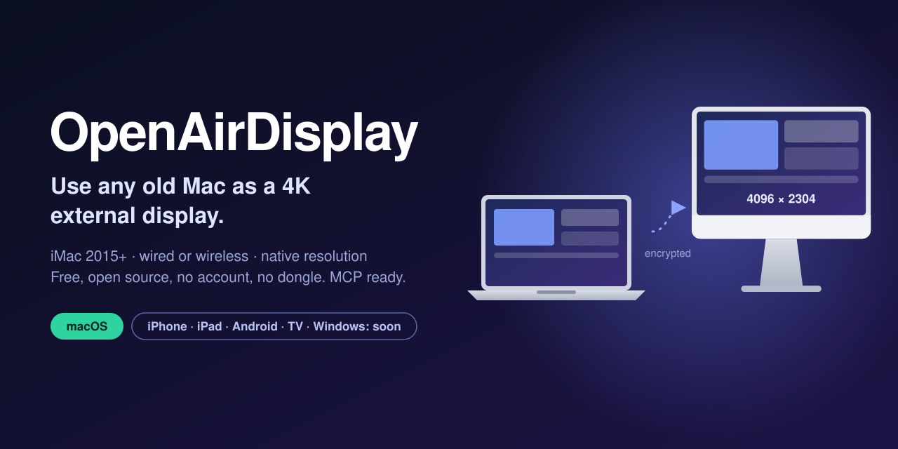
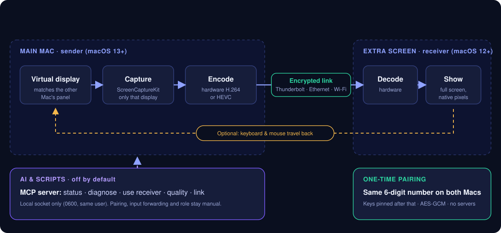

<div align="center">



# OpenAirDisplay

**Use an old iMac (2015+) or any old Mac as a real 4K external display for your MacBook.**
Wired or wireless. Free, open source, no account, no dongle.

[](https://github.com/sanangoyal/OpenAirDisplay/releases/latest)
[](LICENSE)
[](#requirements)
[](#requirements)

[Install](#install) · [Set up](#set-up-in-two-minutes) · [Compare](#how-it-compares) · [AI control](#control-it-with-ai-mcp) · [FAQ](#faq) · [Roadmap](#roadmap)

</div>

---

## Why

A 2015 iMac with a 4K Retina panel is still a beautiful screen, but Apple's Target Display Mode never covered Retina iMacs, Sidecar only works with an iPad, and paid alternatives want a dongle or a subscription.

OpenAirDisplay turns that iMac (or an old MacBook, or a Mac mini on a spare monitor) into a true **extended display** for your newer Mac. Not a mirror: a second desktop you drag windows onto.

| | |
|---|---|
| **Native resolution** | Matches the other Mac's panel, HiDPI included: **4096 × 2304** on a 2015 iMac 4K. |
| **Low latency** | Hardware H.264, and HEVC where supported. About 1 ms round trip over a cable, 50 fps at 4K in our tests. |
| **Wired or wireless** | Thunderbolt or Ethernet is best, Wi-Fi works, and it switches to a cable by itself when you plug one in. |
| **Private** | Direct link between your two Macs. No servers, accounts or telemetry. Everything on the wire is encrypted. |
| **AI-controllable** | Built-in [MCP server](#control-it-with-ai-mcp): ask an assistant to diagnose lag or change quality. Off by default. |

> **Status:** early release. Tested on a late-2015 iMac 4K (extra screen) and Apple silicon MacBooks (main Mac, and extra screen too). Expect rough edges; issues and pull requests welcome.

## Install

Download `OpenAirDisplay-<version>.dmg` from the [latest release](https://github.com/sanangoyal/OpenAirDisplay/releases/latest) and drag the app to Applications on **both** Macs.

The app is not notarized yet, so macOS blocks the first launch. Open **System Settings › Privacy & Security** and click **Open Anyway** (right-click › Open no longer works on recent macOS). Or run `xattr -cr /Applications/OpenAirDisplay.app` in Terminal.

<details>
<summary>Build from source instead</summary>

Needs only the Xcode Command Line Tools.

```sh
xcode-select --install          # once
git clone https://github.com/sanangoyal/OpenAirDisplay && cd OpenAirDisplay
scripts/build.sh --install      # universal app (Intel + Apple silicon) in ~/Applications
```

Tip: sign with a stable certificate so macOS keeps the Screen Recording permission across rebuilds: `SIGN_ID="My Local Signing" scripts/build.sh --install`.

</details>

## Set up in two minutes

1. **Old Mac** (the new screen): open OpenAirDisplay, choose **Be the extra screen**.
2. **Main Mac**: open OpenAirDisplay, choose **Use another Mac as my display**.
3. Both show the **same 6-digit number**. If they match, click Pair on each, and allow Screen Recording when asked.
4. A new display appears in System Settings › Displays. Arrange it and drag windows over. After this, the Macs reconnect by themselves.

Press **Esc** on the extra screen to pause and use that Mac normally.

## Requirements

| Role | macOS | Notes |
|---|---|---|
| **Main Mac** (sends) | 13 Ventura or later, Apple silicon or Intel | Needs Screen Recording permission |
| **Extra screen** (receives) | 12 Monterey or later, Apple silicon or Intel | Hardware H.264 decode |

Both Macs need the same network, or an Ethernet or Thunderbolt/USB bridge cable.

<details>
<summary>Which old Macs qualify?</summary>

macOS 12 Monterey runs on iMacs from late 2015, MacBook Air/Pro from early 2015, and Mac minis from late 2014. That sets the oldest usable extra screen. A Mac stuck on macOS 12 can only be the extra screen; the app locks the sender role there.

**Tested:** iMac 21.5" 4K (late 2015, macOS 12.7) as extra screen; Apple silicon MacBooks as main Mac and as extra screen. Others should work; [reports welcome](https://github.com/sanangoyal/OpenAirDisplay/issues). 5K iMacs are untested.

</details>

## How it works



<sub>Technical: virtual display via the private `CGVirtualDisplay` API, capture with ScreenCaptureKit, encode with VideoToolbox, one encrypted TCP connection, hardware decode and `AVSampleBufferDisplayLayer` on the receiver. Discovery uses Bonjour (`_odisplay._tcp`, port 7777).</sub>

## Features

| | |
|---|---|
| **Extended, not mirrored** | A new virtual display, arranged like any monitor. |
| **4K and beyond** | Matches the receiver's panel, including Retina HiDPI. H.264 receivers cap near 56 fps at 4096 × 2304 (hardware decoder limit); HEVC receivers do not. |
| **HEVC when available** | Used automatically when the extra screen can decode it in hardware. Sharper at the same bit rate. |
| **Several extra screens** | Pair more than one Mac and tick each under Receivers. Each gets its own virtual display. |
| **Quality presets** | Auto (adapts to the link), Ultra, Best, Balanced, Light, "Smooth 4K 60". |
| **Automatic link choice** | Prefers wired, notifies you when a cable appears, or force Wired / Wi-Fi only. |
| **Keyboard and mouse (opt-in)** | Use the old Mac's own keyboard and mouse on your main Mac. Hold Esc 1.5 s to leave; ⌃⌥⌘D on the main Mac pauses any time. |
| **Sound** | Optionally plays the main Mac's audio on the extra screen's speakers. |
| **Wake-on-LAN** | Wake a sleeping extra screen from the menu, or automatically. |
| **One app, two roles** | Pick the role at first launch; change it in Settings. |
| **Live stats** | Frame rate, bit rate, ping, drops, capture + encode time. |
| **Power saving** | Optional 30 fps cap on battery. |

## How it compares

|  | **OpenAirDisplay** | [OpenDisplay](https://github.com/peetzweg/opendisplay) | Apple Sidecar | Luna Display | Duet Display |
|---|---|---|---|---|---|
| Old **Mac** as the display | **Yes** | Yes | No | Yes | Yes |
| iPhone / iPad as the display | Coming soon | Yes | iPad only | Yes | Yes |
| Cost | Free | Free | Built in | One-time purchase | See [vendor](https://www.duetdisplay.com) |
| Open source | **MIT** | GPL-3.0 | No | No | No |
| Extra hardware | None | None | None | Dongle (about $89.99) | None |
| Main Mac needs | macOS 13+ | macOS 14+ | Built in | See vendor | See vendor |
| Receiver needs | macOS 12+ | macOS 12+ (Mac), iOS 15+ | n/a | macOS 10.13+ | macOS 10.13 to 10.15 (Intel app) |
| HEVC | **Yes** | Planned | n/a | n/a | n/a |
| Keyboard, mouse and sound from the extra Mac | **Yes** | Not yet | n/a | n/a | n/a |
| AI / MCP control | **Built in** (opt-in) | Not documented | No | No | No |
| Account / servers | None | None | Apple Account | Vendor apps | Vendor apps |

<sub>Checked October 2026 from [OpenDisplay's README](https://github.com/peetzweg/opendisplay), Apple's [Sidecar page](https://support.apple.com/en-us/102597), the [Luna Display store](https://shop.astropad.com/products/luna-display) and [duetdisplay.com](https://www.duetdisplay.com). Products change; [open an issue](https://github.com/sanangoyal/OpenAirDisplay/issues) if something is out of date. Each has strengths we lack: OpenDisplay, Luna and Duet reach iPhone or iPad today, Duet also Windows and Android, and Sidecar is seamless with iPad. "n/a": not applicable or not published.</sub>

## Control it with AI (MCP)

OpenAirDisplay speaks [MCP](https://modelcontextprotocol.io), so AI assistants and scripts can control it without menus. **Off by default:** turn on *Settings › General › Allow AI agents & scripts*, then use the copy buttons there.

```sh
claude mcp add openairdisplay -- /Applications/OpenAirDisplay.app/Contents/MacOS/OpenAirDisplay --mcp
```

Ask things like "why is my second screen laggy?", "switch to the wired link", or "drop quality to light".

<details>
<summary>Other MCP clients, tool list and security</summary>

Config for Claude Desktop, Cursor and others:

```json
{ "mcpServers": { "openairdisplay": { "command": "/Applications/OpenAirDisplay.app/Contents/MacOS/OpenAirDisplay", "args": ["--mcp"] } } }
```

| Tool | What it does |
|---|---|
| `diagnose` | Health report: permissions, duplicate copies, receivers, link, network route, recent events, findings with fixes |
| `get_status`, `list_receivers` | Live stats and paired Macs |
| `use_receiver`, `stop_using_receiver` | Start or stop a paired Mac as a screen |
| `pause_streaming`, `resume_streaming`, `restart_stream` | Control the stream |
| `set_quality`, `set_link` | Quality preset; auto, wired or Wi-Fi |

Scripts can call the same commands: `OpenAirDisplay --ctl get_status`.

**Security:** the app listens on a Unix socket in `~/Library/Application Support/OpenAirDisplay/` (mode 0600, caller's user checked), never on the network. Pairing a new Mac, keyboard/mouse forwarding, the role and reset are not exposed; they always need you. Settings lists every request with the program that made it.

</details>

## FAQ

<details>
<summary><b>Can I use a 2015 iMac as an external display for my MacBook?</b></summary>

Yes, that is what this was built for. Install on both Macs, pair them, and the iMac becomes a second display at full native resolution (4096 × 2304 on the 4K model).

</details>

<details>
<summary><b>Is this a Target Display Mode alternative?</b></summary>

Yes, for Macs that lack it. Target Display Mode does not cover Retina 4K and 5K iMacs, and newer Macs do not have it at all. OpenAirDisplay works over the network or a cable, in software.

</details>

<details>
<summary><b>Does it work over Wi-Fi?</b></summary>

Yes, and quality adapts automatically, but a cable (Thunderbolt or Ethernet) is far smoother at 4K. With AirDrop set to "Everyone", macOS periodically scans and can cause hitches; set it to Contacts Only.

</details>

<details>
<summary><b>Why is 4K capped around 56 fps?</b></summary>

Only on H.264 receivers: 4096 × 2304 at 60 fps exceeds H.264 Level 5.2, and level 6 streams black-screen the hardware decoder on Intel iMacs. "Smooth 4K 60" trades a little sharpness for a steady 60. HEVC receivers are not capped.

</details>

<details>
<summary><b>Can I use an iPad, iPhone, Android phone, TV or Windows PC?</b></summary>

Not yet; see the [roadmap](#roadmap).

</details>

<details>
<summary><b>Can I play Netflix or other protected video on the extra screen?</b></summary>

Play it on the extra Mac itself. macOS hides DRM-protected video from screen capture, as with Sidecar and other display apps, so it shows black when mirrored.

</details>

<details>
<summary><b>Why the purple recording indicator on my main Mac?</b></summary>

macOS shows it whenever an app captures the screen. OpenAirDisplay captures only its own virtual display, and nothing is stored.

</details>

<details>
<summary><b>Why isn't it on the Mac App Store?</b></summary>

It relies on a private API (`CGVirtualDisplay`), which the App Store does not allow. It may break with a future macOS update.

</details>

<details>
<summary><b>Can I use an Intel MacBook as the main Mac?</b></summary>

It should work on macOS 13+, but it is untested. Reports welcome.

</details>

<details>
<summary><b>Is the connection encrypted?</b></summary>

Yes. Ed25519 identity keys are pinned at pairing, session keys come from X25519, and frames are sealed with AES-GCM. The pairing number is a short authentication string with a commit-reveal step, so someone in the middle can't pick keys that make the numbers match. This is a hobby project without an independent security audit; see [SECURITY.md](SECURITY.md).

</details>

<details>
<summary><b>Is it related to "Air Display" by Avatron?</b></summary>

No. It is an independent project with a similar-sounding generic name.

</details>

## Limitations

- Private API; may break on new macOS releases.
- Protected (DRM) video shows black when captured.
- Input forwarding is basic: system shortcuts on the extra Mac (Cmd+Tab, Mission Control) stay local, and it needs Accessibility permission on the main Mac.
- The main Mac needs macOS 13+.
- Several extra screens work, but only the first gets sound, and multi-screen is tested in code, not yet with three real Macs.
- Not notarized.

## Privacy

No accounts, analytics, telemetry or servers, and no internet connections. Video, sound and input go directly between your two paired Macs, encrypted. Each Mac stores only its settings and the public keys of paired Macs.

<details>
<summary>Permissions it asks for</summary>

**Screen Recording** (capture the virtual display it creates), **Local Network** (find your other Mac), **Accessibility** (only if you turn on keyboard and mouse from the extra screen), **Notifications** (optional banners).

</details>

## Roadmap

| Platform | Status |
|---|---|
| macOS to macOS | **Available** |
| iPhone and iPad as the display | Coming soon |
| Android phones and tablets | Coming soon |
| TV | Coming soon |
| Windows | Coming soon |
| Notarized releases, Homebrew cask | Planned |

Want to build one of these? Open an issue to coordinate first.

## Contributing

Issues and pull requests welcome: [CONTRIBUTING.md](CONTRIBUTING.md). Changes: [CHANGELOG.md](CHANGELOG.md). Report vulnerabilities privately as described in [SECURITY.md](SECURITY.md).

---

<div align="center">

Made by [Sanan Goyal](https://sanangoyal.com) · [MIT License](LICENSE)

<sub>Provided "as is", without warranty of any kind. Use at your own risk; the author is not liable for damage, data loss or hardware problems arising from its use.</sub>

<sub>Not affiliated with or endorsed by Apple Inc., Astropad, Duet or the OpenDisplay project. Mac, macOS, iMac, MacBook, Thunderbolt, AirDrop, iPhone, iPad and Sidecar are trademarks of Apple Inc.; Luna Display is a trademark of Astropad; Duet Display and OpenDisplay belong to their owners.</sub>

<sub>Keywords: use old iMac as external display, iMac 2015 second monitor, Mac as second screen for MacBook, Target Display Mode alternative, extended display Mac to Mac, 4K external display from old Mac, wired and wireless second display macOS, MCP server for display control.</sub>

</div>
